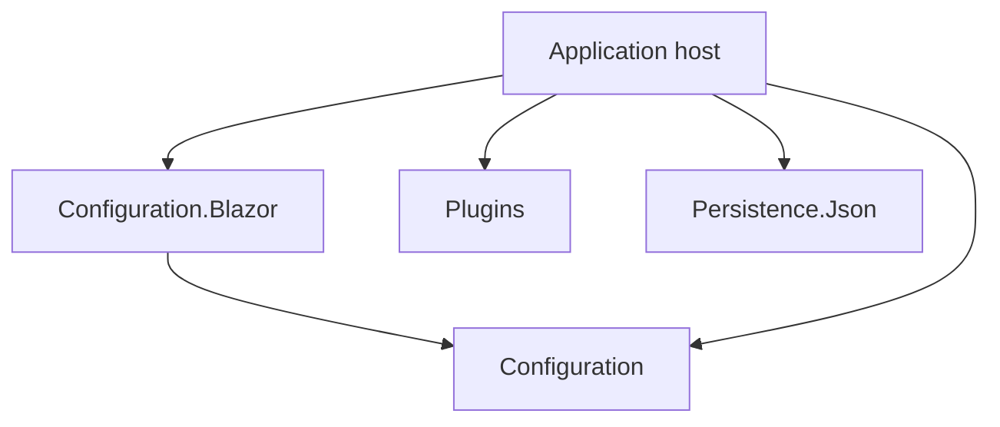
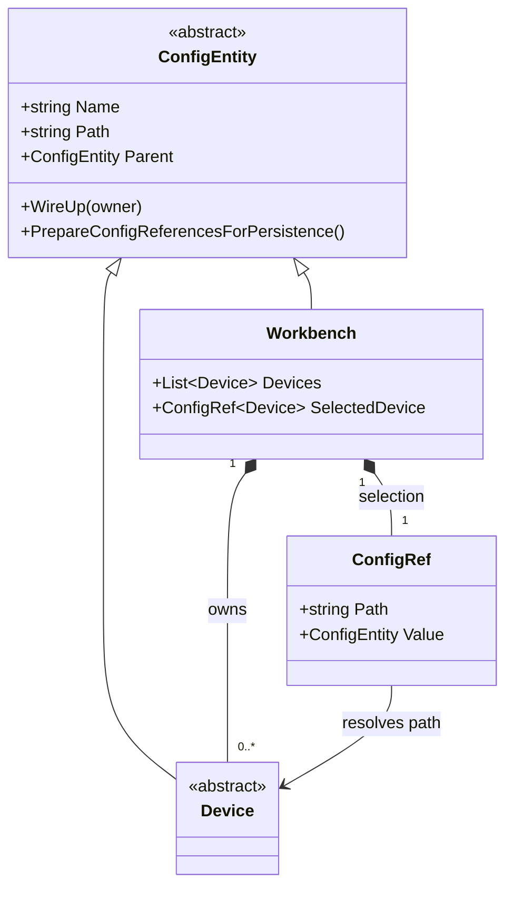
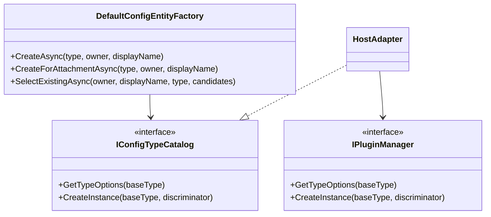
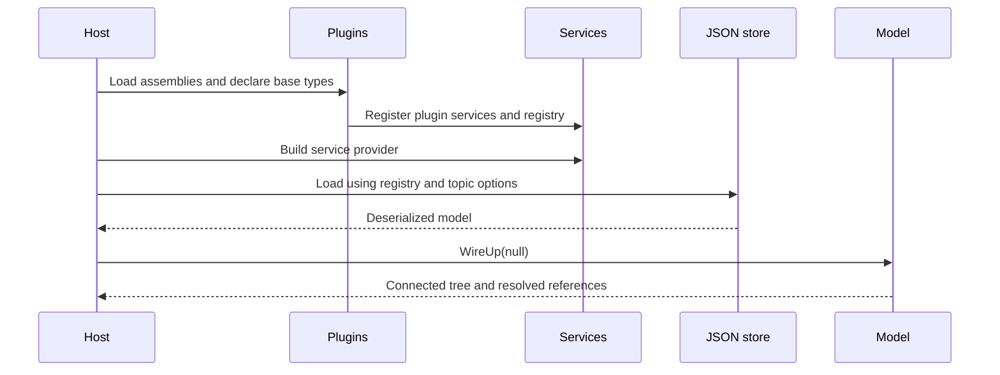

# Architecture

The host connects independent libraries through its own models and adapters.

## Package dependencies

An arrow means “references”. The host adapts the plugin registry to `IConfigTypeCatalog`; this does not add a dependency between the two packages.

## Configuration objects and references

Composition owns children; references point to existing objects by path.

## Editor extension boundary

The host implements `IConfigTypeCatalog` using a fixed list or a plugin registry.

## Startup and configuration loading

Plugin services are registered before DI is built; deserialization uses the registered type identifiers.

For the save lifecycle and validation rules, see [Configuration](configuration.md#lifecycle) and [JSON persistence](persistence.md#write-lifecycle).
