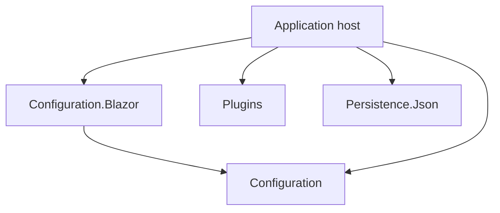
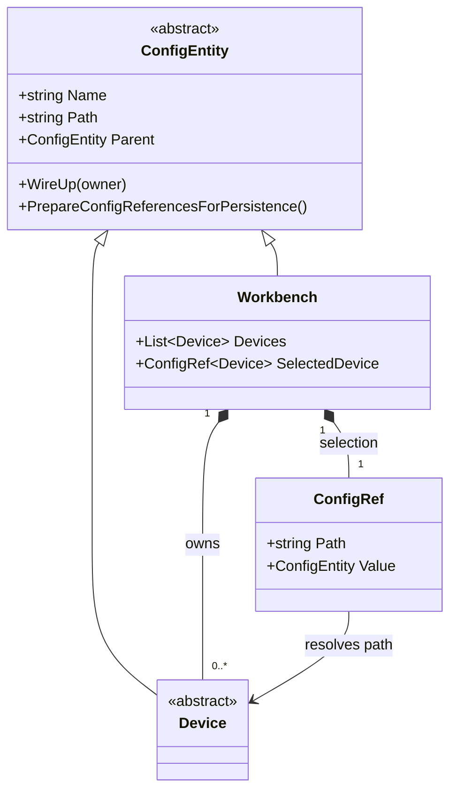
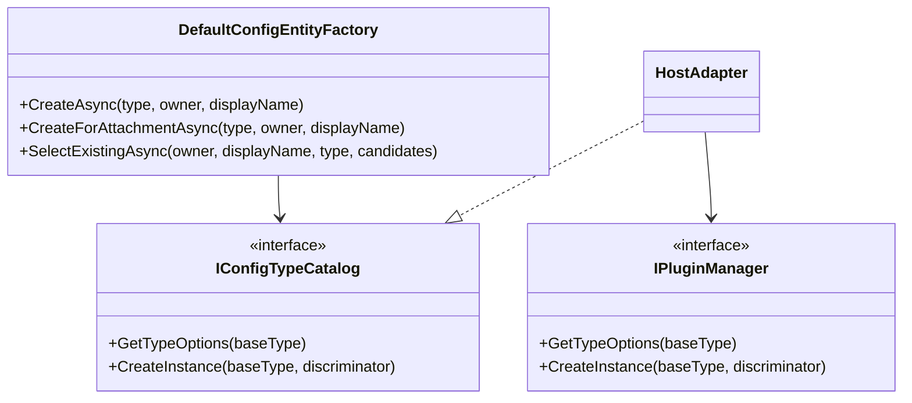
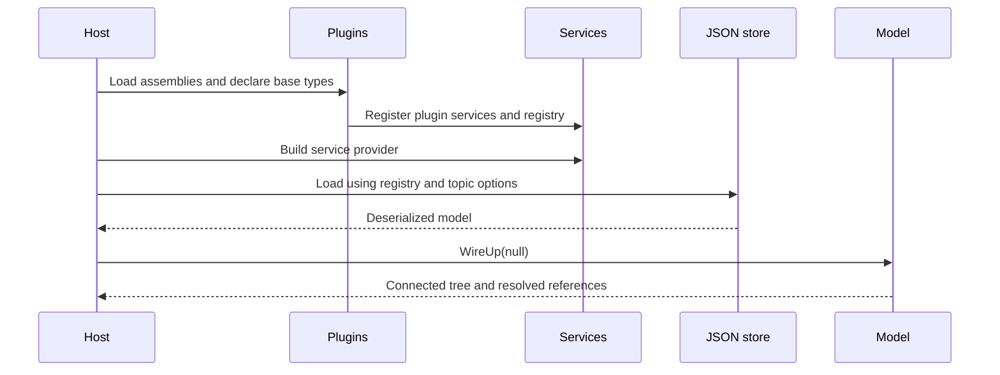

# Architecture

The application chooses the available extension points and connects the packages. A library does not know about greenhouse equipment or the host's user accounts.

## Package dependencies

An arrow means “references”. The host adapts the plugin registry to `IConfigTypeCatalog`; this does not add a dependency between the two packages.

| Package | External dependencies | Does not own |
| --- | --- | --- |
| Plugins | Microsoft.Extensions dependency injection, configuration and logging abstractions; System.Text.Json | Host model, web components, plugin settings schema |
| Configuration | Logging abstractions; System.Text.Json | Plugin loading, file paths, users, database |
| Configuration.Blazor | ASP.NET Core, MudBlazor, Configuration | Persistence policy, authentication, available implementations |
| Persistence.Json | Logging abstractions; System.Text.Json | Model validation, serializers specific to an application |

## Configuration objects and references

Composition belongs in serialized child properties. A `ConfigRef` points to an object already owned elsewhere in the tree; its `Value` is not serialized again.

## Editor extension boundary

The editor receives choices and an instance factory through a configuration-owned interface. Hosts can implement this with a fixed list, a plugin registry, or another source.

## Startup and configuration loading

Plugin configuration runs before the DI service provider is built. JSON deserialization uses the discovered implementation registry; arbitrary `$type` names are rejected.

## Save flow

1. The host applies its edit permission and concurrency policy.
2. The editor mutates the model and raises `OnConfigChanged`.
3. The host rewires the tree and performs application validation.
4. `PrepareConfigReferencesForPersistence` rejects missing required or unresolved references.
5. The JSON store serializes with caller-supplied options and replaces the destination.

Reference integrity and field validation are different checks. A host using the model without the editor must enforce its own DataAnnotations and application rules.
