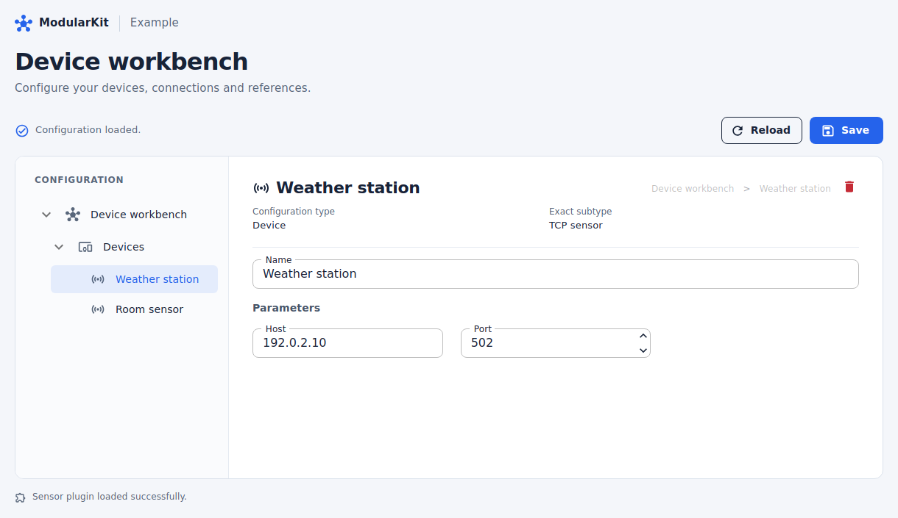
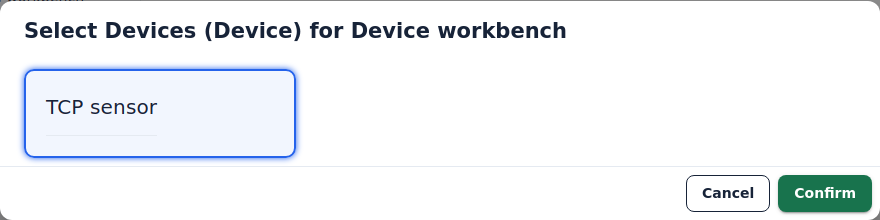
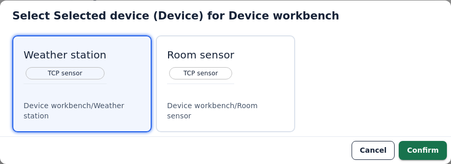
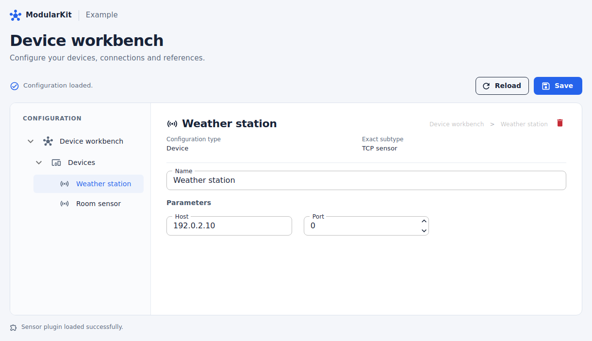
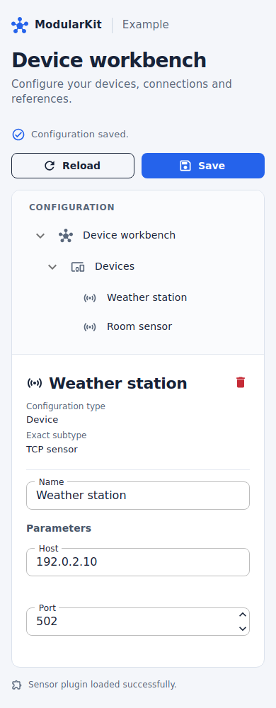

# Blazor UI

`ModularKit.Configuration.Blazor` provides a configuration editor for Blazor applications using MudBlazor. The screens below come from the DeviceWorkbench sample, using two example sensors. The sample supplies the page layout and save/reload buttons; the library supplies the tree, forms and dialogs.

## Browse and edit configuration

Select an object in the tree to display its settings. The editor generates the name, host and numeric fields from the C# model and its attributes.



## Choose a component implementation

When adding an abstract component, choose one of the implementations supplied by the host's type catalog. This sample loads a TCP sensor implementation from a separate plugin assembly.



## Reference an existing object

Select an existing device instead of creating another copy. The dialog shows each object's name, type and path to distinguish similar items.



## Validate field values

Field validation displays errors beside the input. Here, a port value of zero violates the sample model's allowed range of 1 to 65535.



## Try the screens

The sample adapts to narrow screens by stacking navigation above the settings form.

<details>
<summary>View the mobile layout</summary>



</details>

```sh
dotnet run --project samples/DeviceWorkbench --urls http://localhost:5080
```

Open `http://localhost:5080`, select **Devices** and add a **TCP sensor**. Create a second sensor to try the existing-object selector. The screenshots use the example names **Weather station** and **Room sensor**, with documentation addresses `192.0.2.10` and `192.0.2.11`. The sample does not connect to these addresses.

See the [sample guide](../samples/DeviceWorkbench/README.md) for save/reload steps and the [editor guide](editor.md) to integrate these components into your own application.
