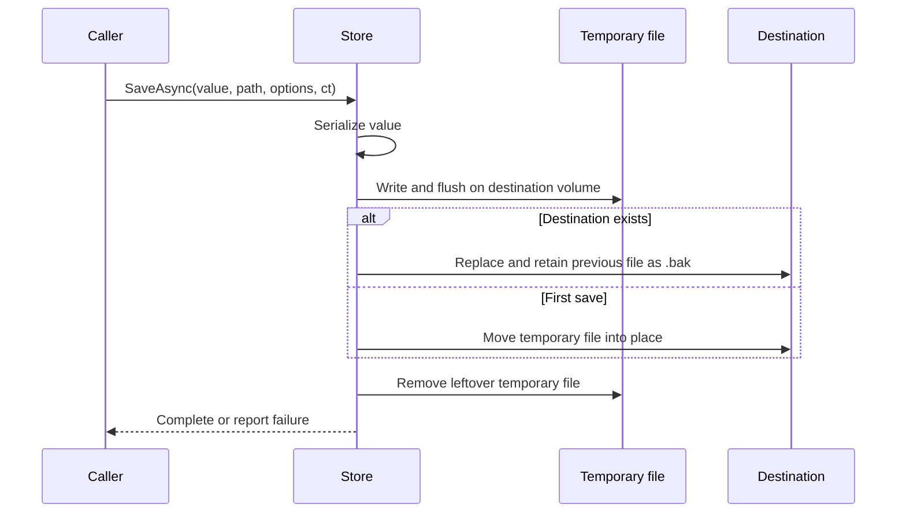

# JSON persistence

`ModularKit.Persistence.Json` accepts any class and caller-supplied `JsonSerializerOptions`. It does not depend on configuration models, plugins or ASP.NET Core.

```csharp
IJsonFileStore store = new JsonFileStore(loggerFactory);
await store.SaveAsync(model, new FileInfo("storage/config.json"), options, cancellationToken);
var loaded = await store.LoadAsync<MyConfig>(new FileInfo("storage/config.json"), options, cancellationToken);
```

Register it in DI with `services.AddSingleton<IJsonFileStore, JsonFileStore>()` when a logger factory is available.

## Write lifecycle



The store creates the parent directory. A temporary file is written beside the target, then flushed before replacement. On replacement the previous target becomes `<filename>.bak`. A failed serialization or cancelled write before replacement leaves the old target intact; temporary-file cleanup runs in `finally`.

## Errors and cancellation

- Read failures caused by IO or JSON parsing are wrapped in `ApplicationException`, retaining the original exception.
- Write failures caused by IO, JSON parsing or access permissions are wrapped in `ApplicationException`.
- Cancellation propagates as `OperationCanceledException`.
- File replacement is synchronous. Cancellation arriving after replacement starts cannot roll it back.
- A missing file is an error; the caller decides whether to create defaults.
- Backup recovery is explicit. The library never silently falls back to `.bak` or resets a corrupt configuration.

## Limits

This is a single-file store, not a transaction system. It does not coordinate concurrent writers, enforce expected versions, encrypt secrets, migrate schemas, impose size limits or rotate backups. Serializing the object and reading a file both use memory proportional to JSON size. Coordinate writes and object access in the host.

Replacement semantics depend on the operating system and filesystem. A local filesystem on the same volume is the intended use. A flushed temporary file and replacement do not constitute a guarantee against every power-loss scenario or provide database-grade durability. Network shares need their own validation.
