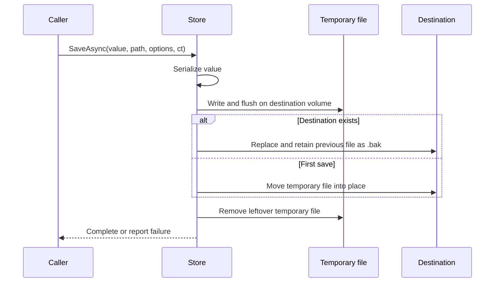

# JSON persistence

`ModularKit.Persistence.Json` stores any class with caller-supplied `JsonSerializerOptions`, independently of the other packages.

```csharp
using System.Text.Json;
using Microsoft.Extensions.Logging.Abstractions;
using ModularKit.Persistence.Json;

IJsonFileStore store = new JsonFileStore(NullLoggerFactory.Instance);
var file = new FileInfo("storage/settings.json");
var options = new JsonSerializerOptions { WriteIndented = true };
await store.SaveAsync(new Settings("localhost"), file, options, CancellationToken.None);
var loaded = await store.LoadAsync<Settings>(file, options, CancellationToken.None);

public sealed record Settings(string Host);
```

For DI, register `services.AddSingleton<IJsonFileStore, JsonFileStore>()` with a logger factory available.

## Write lifecycle



Parent directories are created automatically. Replacement keeps the previous file as `<filename>.bak`. Failed serialization or cancellation before replacement leaves the old target intact.

## Errors and limits

- Read IO/JSON failures and write IO/JSON/access failures are wrapped in `ApplicationException`, preserving the cause. Cancellation propagates as `OperationCanceledException`.
- Replacement is synchronous; cancellation cannot roll it back once started.
- Missing or corrupt files are errors. Defaults and backup recovery are explicit host decisions.
- The host coordinates concurrent writers, model validation and schema upgrades. The store provides no version checks, encryption, size limits or backup rotation.
- Reads and serialization use memory proportional to JSON size. Replacement is intended for a local filesystem on the same volume; network shares and power-loss durability need separate validation.
